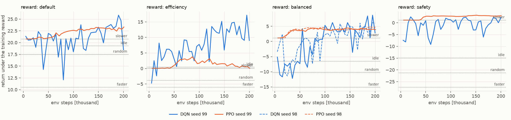
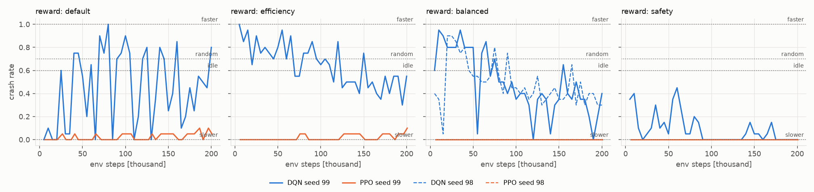
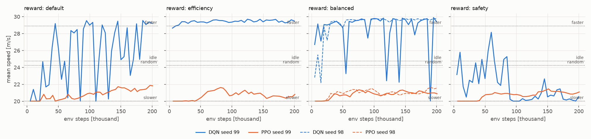
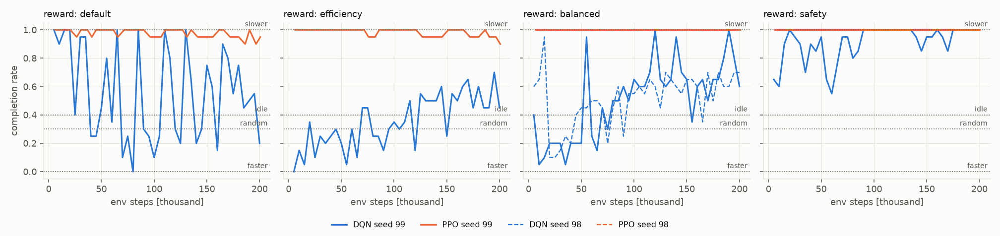

# Calibration with Stable-Baselines3

Generated by `python -m scripts.calibration.analyze` from the files in `results/calibration/` (nothing here is typed by hand except section 6). **Calibration only.** Reference implementations from Stable-Baselines3 2.9.2 were trained in our environment to check, before anything is frozen and before the main grid, what the scripted-baseline pilot could not check. They are never part of the DDQN vs PPO comparison and never enter the main tables. **SB3 DQN is vanilla DQN with a target network (max target), not Double DQN**; SB3 PPO is a reference PPO. All numbers use the 20 `VAL_SEEDS` (never `TEST_SEEDS`); with 20 episodes one episode moves the crash rate by 5 points. **The interpretation, the recommendations and the answers to Q1-Q4 are in section 6 at the end.**

## 0. What was run

| algorithm | reward | seed | env steps | wall [min] | training steps/s (no validation) | validation share of wall [%] | val. points |
|---|---:|---:|---:|---:|---:|---:|---:|
| DQN | balanced | 98 | 200,000 | 247.6 | 14.6 | 7.8 | 40 |
| DQN | balanced | 99 | 200,000 | 249.0 | 14.5 | 7.8 | 40 |
| DQN | default | 99 | 200,000 | 248.0 | 14.6 | 8.0 | 40 |
| DQN | efficiency | 99 | 200,000 | 247.5 | 14.5 | 7.2 | 40 |
| DQN | safety | 99 | 200,000 | 247.3 | 14.8 | 9.0 | 40 |
| PPO | balanced | 98 | 200,704 | 50.6 | 82.0 | 19.4 | 40 |
| PPO | balanced | 99 | 200,704 | 51.5 | 80.7 | 19.5 | 40 |
| PPO | default | 99 | 200,704 | 52.4 | 79.0 | 19.2 | 40 |
| PPO | efficiency | 99 | 200,704 | 49.3 | 84.6 | 19.7 | 40 |
| PPO | safety | 99 | 200,704 | 53.1 | 78.0 | 19.2 | 40 |

Plan limit 7.0 h; estimated 5.60 h; dropped before the start: none.
 Actual: training 4.36 h, whole plan 4.59 h.

### Resumes

| run | resumes | resumed at env step |
|---|---:|---:|
| DQN balanced s98 | 3 | 8,770, 65,676, 138,220 |
| DQN efficiency s99 | 1 | 162,426 |
| DQN safety s99 | 2 | 73,343, 73,343 |
Each resume restarted from the last checkpoint (written every ~10 min of wall time) with the in-flight episodes restarted under new derived seeds, so these runs are not bit-identical to an uninterrupted run. All resumes were caused by `PermissionError` on `os.replace` of `progress.json` (OneDrive / the orchestrator reading the file) in processes started before the retry fix; the PPO runs, started later, never failed. The lost work was at most one checkpoint interval per resume.

### Hyperparameters (no tuning, identical for all rewards)

**SB3 DQN (vanilla, not Double)**

| parameter | value | source |
|---|---:|---:|
| learning_rate | 0.0005 | HighwayEnv scripts/sb3_highway_dqn.py (master, fetched 2026-11-21) |
| buffer_size | 15000 | HighwayEnv scripts/sb3_highway_dqn.py (master, fetched 2026-11-21) |
| learning_starts | 200 | HighwayEnv scripts/sb3_highway_dqn.py (master, fetched 2026-11-21) |
| batch_size | 32 | HighwayEnv scripts/sb3_highway_dqn.py (master, fetched 2026-11-21) |
| gamma | 0.99 | frozen shared decision (common/train_config.py); the example uses 0.8 |
| train_freq | 1 | HighwayEnv scripts/sb3_highway_dqn.py (master, fetched 2026-11-21) |
| gradient_steps | 1 | HighwayEnv scripts/sb3_highway_dqn.py (master, fetched 2026-11-21) |
| target_update_interval | 50 | HighwayEnv scripts/sb3_highway_dqn.py (master, fetched 2026-11-21) |
| exploration_fraction | 0.3 | calibration task specification: epsilon reaches its final value at 30% of the run (example: SB3 default 0.1) |
| exploration_initial_eps | 1.0 | SB3 2.9.2 default (the HighwayEnv example gives no value) |
| exploration_final_eps | 0.05 | SB3 2.9.2 default (the HighwayEnv example gives no value) |
| tau | 1.0 | SB3 2.9.2 default (the HighwayEnv example gives no value) (hard target update) |
| max_grad_norm | 10 | SB3 2.9.2 default (the HighwayEnv example gives no value) |
| net_arch | [256, 256] | frozen shared decision (common/train_config.py), same as the example |
| activation_fn | "ReLU" | frozen shared decision (common/train_config.py); SB3 DQN default |

**SB3 PPO**

| parameter | value | source |
|---|---:|---:|
| learning_rate | 0.0003 | calibration task specification (= SB3 default) |
| n_envs | 8 | calibration task specification |
| n_steps | 256 | calibration task specification |
| batch_size | 64 | calibration task specification (= SB3 default) |
| n_epochs | 10 | calibration task specification (= SB3 default) |
| gamma | 0.99 | frozen shared decision (common/train_config.py) |
| gae_lambda | 0.95 | calibration task specification (= SB3 default) |
| clip_range | 0.2 | calibration task specification (= SB3 default) |
| ent_coef | 0.0 | calibration task specification (= SB3 default) |
| vf_coef | 0.5 | SB3 2.9.2 default (the HighwayEnv example gives no value) |
| max_grad_norm | 0.5 | SB3 2.9.2 default (the HighwayEnv example gives no value) |
| normalize_advantage | true | SB3 2.9.2 default (the HighwayEnv example gives no value) |
| target_kl | null | SB3 2.9.2 default (the HighwayEnv example gives no value) |
| net_arch | {"pi": [256, 256], "vf": [256, 256]} | frozen shared decision (common/train_config.py) (separate actor and critic, as in the main grid) |
| activation_fn | "ReLU" | frozen shared decision (common/train_config.py) |

PPO collects whole rollouts of 8 x 256 = 2048 steps; 200,000 is not a multiple, so PPO ran 200,704 env steps (98 rollouts) and DQN exactly 200,000. Weight initialisation is SB3's own (orthogonal for PPO), not the main grid's. Validation every 5,000 env steps (PPO: at the first rollout boundary after each multiple, after the update), 20 deterministic episodes, `val_log.csv` in exactly the main-grid schema, plus the per-episode records in `val_episodes.csv`.

## 1. Q1: do the four reward presets lead to different learned behaviour?

#### SB3 DQN (vanilla, not Double), final models, `main` condition, seed 99, 20 `VAL_SEEDS` episodes

| trained with | crash_rate | completion_rate | mean_speed | lane_changes | lane_change_reversals | rightmost_lane_share | overtakes_per_km | near_miss_rate | crashes_per_km |
|---|---:|---:|---:|---:|---:|---:|---:|---:|---:|
| default | 0.25 | 0.75 | 25.97 | 2.65 | 0.15 | 0.08 | 4.73 | 0.10 | 0.34 |
| efficiency | 0.50 | 0.50 | 29.62 | 3.70 | 0.25 | 0.29 | 8.16 | 0.40 | 0.67 |
| balanced | 0.45 | 0.55 | 29.39 | 5.40 | 1.95 | 0.68 | 7.98 | 0.55 | 0.64 |
| safety | 0.00 | 1.00 | 20.53 | 1.70 | 0.20 | 0.85 | 0.32 | 0.05 | 0.00 |

Action histogram (share of the steps) and return under every preset (rows: training reward; the diagonal is the model's own return):

| trained with | LANE_LEFT | IDLE | LANE_RIGHT | FASTER | SLOWER | return_default | return_efficiency | return_balanced | return_safety |
|---|---:|---:|---:|---:|---:|---:|---:|---:|---:|
| default | 31% | 63% | 5% | 1% | 0% | 23.5 | 9.5 | 2.0 | -4.8 |
| efficiency | 7% | 0% | 10% | 82% | 0% | 23.6 | 12.0 | 0.6 | -10.8 |
| balanced | 11% | 1% | 69% | 19% | 0% | 23.1 | 11.8 | 1.7 | -9.6 |
| safety | 1% | 12% | 41% | 2% | 44% | 22.2 | 1.3 | 3.2 | 2.2 |

#### SB3 PPO, final models, `main` condition, seed 99, 20 `VAL_SEEDS` episodes

| trained with | crash_rate | completion_rate | mean_speed | lane_changes | lane_change_reversals | rightmost_lane_share | overtakes_per_km | near_miss_rate | crashes_per_km |
|---|---:|---:|---:|---:|---:|---:|---:|---:|---:|
| default | 0.05 | 0.95 | 21.83 | 1.25 | 0.00 | 0.98 | 0.69 | 0.00 | 0.08 |
| efficiency | 0.10 | 0.90 | 20.82 | 17.80 | 14.90 | 0.18 | 0.35 | 0.00 | 0.17 |
| balanced | 0.00 | 1.00 | 20.90 | 1.25 | 0.00 | 0.98 | 0.48 | 0.00 | 0.00 |
| safety | 0.00 | 1.00 | 21.10 | 1.25 | 0.00 | 0.98 | 0.47 | 0.00 | 0.00 |

Action histogram (share of the steps) and return under every preset (rows: training reward; the diagonal is the model's own return):

| trained with | LANE_LEFT | IDLE | LANE_RIGHT | FASTER | SLOWER | return_default | return_efficiency | return_balanced | return_safety |
|---|---:|---:|---:|---:|---:|---:|---:|---:|---:|
| default | 0% | 2% | 41% | 14% | 43% | 23.3 | 3.7 | 4.0 | 1.9 |
| efficiency | 60% | 0% | 33% | 0% | 6% | 19.9 | 0.1 | -2.0 | -10.5 |
| balanced | 0% | 0% | 4% | 7% | 89% | 22.7 | 2.2 | 3.9 | 2.9 |
| safety | 0% | 1% | 6% | 10% | 83% | 22.9 | 2.6 | 4.2 | 3.0 |

**Intended ordering** (efficiency fastest and riskiest, safety slowest and safest, balanced in between, safety with the fewest lane changes):

- DQN: speed: efficiency > balanced > safety: **yes**; crash rate: efficiency > balanced > safety: **yes**; crashes/km: efficiency > balanced > safety: **yes**; safety has the fewest lane changes: **yes**; efficiency fastest: **yes**; safety slowest: **yes**
- PPO: speed: efficiency > balanced > safety: **NO**; crash rate: efficiency > balanced > safety: **NO**; crashes/km: efficiency > balanced > safety: **NO**; safety has the fewest lane changes: **NO**; efficiency fastest: **NO**; safety slowest: **NO**

**Differences between presets vs the seed-to-seed spread.** The spread is |seed 99 - seed 98| of the balanced final model (two seeds, rough, see Q3); the second column is sampling noise of the 20-episode means (2 sqrt(2) x SE, the 95% band of a difference of two independent 20-episode means). A difference counts as larger than the spread only if it exceeds both.

#### SB3 DQN (vanilla, not Double)

| pair | metric | difference | seed spread |99-98| (balanced) | 2 sqrt(2) SE (20 episodes) | exceeds both? |
|---|---:|---:|---:|---:|---:|
| default - efficiency | crash_rate | -0.25 | 0.15 | 0.30 | no |
| default - efficiency | mean_speed | -3.65 | 0.39 | 0.73 | yes |
| default - efficiency | lane_changes | -1.05 | 0.50 | 1.04 | yes |
| default - balanced | crash_rate | -0.20 | 0.15 | 0.29 | no |
| default - balanced | mean_speed | -3.42 | 0.39 | 0.80 | yes |
| default - balanced | lane_changes | -2.75 | 0.50 | 1.26 | yes |
| default - safety | crash_rate | 0.25 | 0.15 | 0.14 | yes |
| default - safety | mean_speed | 5.44 | 0.39 | 0.89 | yes |
| default - safety | lane_changes | 0.95 | 0.50 | 0.97 | no |
| efficiency - balanced | crash_rate | 0.05 | 0.15 | 0.32 | no |
| efficiency - balanced | mean_speed | 0.23 | 0.39 | 0.39 | no |
| efficiency - balanced | lane_changes | -1.70 | 0.50 | 1.25 | yes |
| efficiency - safety | crash_rate | 0.50 | 0.15 | 0.16 | yes |
| efficiency - safety | mean_speed | 9.09 | 0.39 | 0.48 | yes |
| efficiency - safety | lane_changes | 2.00 | 0.50 | 0.96 | yes |
| balanced - safety | crash_rate | 0.45 | 0.15 | 0.16 | yes |
| balanced - safety | mean_speed | 8.86 | 0.39 | 0.55 | yes |
| balanced - safety | lane_changes | 3.70 | 0.50 | 1.18 | yes |

#### SB3 PPO

| pair | metric | difference | seed spread |99-98| (balanced) | 2 sqrt(2) SE (20 episodes) | exceeds both? |
|---|---:|---:|---:|---:|---:|
| default - efficiency | crash_rate | -0.05 | 0.00 | 0.16 | no |
| default - efficiency | mean_speed | 1.01 | 0.68 | 0.73 | yes |
| default - efficiency | lane_changes | -16.55 | 0.00 | 3.17 | yes |
| default - balanced | crash_rate | 0.05 | 0.00 | 0.07 | no |
| default - balanced | mean_speed | 0.93 | 0.68 | 0.74 | yes |
| default - balanced | lane_changes | 0.00 | 0.00 | 0.50 | no |
| default - safety | crash_rate | 0.05 | 0.00 | 0.07 | no |
| default - safety | mean_speed | 0.72 | 0.68 | 0.65 | yes |
| default - safety | lane_changes | 0.00 | 0.00 | 0.50 | no |
| efficiency - balanced | crash_rate | 0.10 | 0.00 | 0.09 | yes |
| efficiency - balanced | mean_speed | -0.08 | 0.68 | 0.76 | no |
| efficiency - balanced | lane_changes | 16.55 | 0.00 | 3.17 | yes |
| efficiency - safety | crash_rate | 0.10 | 0.00 | 0.09 | yes |
| efficiency - safety | mean_speed | -0.29 | 0.68 | 0.68 | no |
| efficiency - safety | lane_changes | 16.55 | 0.00 | 3.17 | yes |
| balanced - safety | crash_rate | 0.00 | 0.00 | 0.00 | no |
| balanced - safety | mean_speed | -0.21 | 0.68 | 0.69 | no |
| balanced - safety | lane_changes | 0.00 | 0.00 | 0.50 | no |

**Pairs of presets that are practically indistinguishable** (no difference in crash rate, mean speed or lane changes exceeds both thresholds): PPO: balanced vs safety.

### Does a higher return mean better driving?

Final models of seed 99, `main` condition (8 models of both algorithms; the model's own preset is marked with *). For every preset p: Spearman correlation across the models between `return_p` and (a) completion rate, (b) crash-free rate, (c) mean speed, (d) near-miss rate. With few models these are rough orderings, not tests.

| return under | rho completion | rho crash-free | rho mean speed | rho near-miss rate |
|---|---:|---:|---:|---:|
| default | -0.63 | -0.63 | 0.90 | 0.53 |
| efficiency | -0.73 | -0.73 | 0.98 | 0.72 |
| balanced | 0.73 | 0.73 | -0.21 | -0.51 |
| safety | 0.90 | 0.90 | -0.50 | -0.56 |

Per model: return under every preset next to the behaviour (rank of the model by that return in brackets):

| model | return_default | return_efficiency | return_balanced | return_safety | crash | speed | lane changes |
|---|---:|---:|---:|---:|---:|---:|---:|
| DQN default* | 23.5 (#2) | 9.5 (#3) | 2.0 (#5) | -4.8 (#5) | 0.25 | 25.97 | 2.65 |
| DQN efficiency* | 23.6 (#1) | 12.0 (#1) | 0.6 (#7) | -10.8 (#8) | 0.50 | 29.62 | 3.70 |
| DQN balanced* | 23.1 (#4) | 11.8 (#2) | 1.7 (#6) | -9.6 (#6) | 0.45 | 29.39 | 5.40 |
| DQN safety* | 22.2 (#7) | 1.3 (#7) | 3.2 (#4) | 2.2 (#3) | 0.00 | 20.53 | 1.70 |
| PPO default* | 23.3 (#3) | 3.7 (#4) | 4.0 (#2) | 1.9 (#4) | 0.05 | 21.83 | 1.25 |
| PPO efficiency* | 19.9 (#8) | 0.1 (#8) | -2.0 (#8) | -10.5 (#7) | 0.10 | 20.82 | 17.80 |
| PPO balanced* | 22.7 (#6) | 2.2 (#6) | 3.9 (#3) | 2.9 (#2) | 0.00 | 20.90 | 1.25 |
| PPO safety* | 22.9 (#5) | 2.6 (#5) | 4.2 (#1) | 3.0 (#1) | 0.00 | 21.10 | 1.25 |

## 2. Q2: are the density levels and test conditions informative for a learned agent?

Final models of seed 99 and the scripted baselines on the five `TEST_CONDITIONS`, 20 `VAL_SEEDS` episodes each (`long`: 60 s episodes, 30 vehicles; `precise`: `highway-v0`, 15 Hz).

**`main`**

| model | crash rate | completion | mean speed [m/s] | crashes/km |
|---|---:|---:|---:|---:|
| DQN default | 0.25 | 0.75 | 25.97 | 0.34 |
| DQN efficiency | 0.50 | 0.50 | 29.62 | 0.67 |
| DQN balanced | 0.45 | 0.55 | 29.39 | 0.64 |
| DQN safety | 0.00 | 1.00 | 20.53 | 0.00 |
| PPO default | 0.05 | 0.95 | 21.83 | 0.08 |
| PPO efficiency | 0.10 | 0.90 | 20.82 | 0.17 |
| PPO balanced | 0.00 | 1.00 | 20.90 | 0.00 |
| PPO safety | 0.00 | 1.00 | 21.10 | 0.00 |
| baseline random | 0.70 | 0.30 | 24.24 | 1.31 |
| baseline idle | 0.60 | 0.40 | 24.76 | 1.00 |
| baseline slower | 0.00 | 1.00 | 20.03 | 0.00 |
| baseline faster | 1.00 | 0.00 | 28.90 | 2.85 |

**`low`**

| model | crash rate | completion | mean speed [m/s] | crashes/km |
|---|---:|---:|---:|---:|
| DQN default | 0.10 | 0.90 | 25.69 | 0.13 |
| DQN efficiency | 0.20 | 0.80 | 29.72 | 0.24 |
| DQN balanced | 0.00 | 1.00 | 29.92 | 0.00 |
| DQN safety | 0.00 | 1.00 | 20.85 | 0.00 |
| PPO default | 0.00 | 1.00 | 27.28 | 0.00 |
| PPO efficiency | 0.10 | 0.90 | 22.19 | 0.16 |
| PPO balanced | 0.00 | 1.00 | 23.95 | 0.00 |
| PPO safety | 0.00 | 1.00 | 26.52 | 0.00 |
| baseline random | 0.40 | 0.60 | 24.80 | 0.71 |
| baseline idle | 0.05 | 0.95 | 24.97 | 0.07 |
| baseline slower | 0.00 | 1.00 | 20.03 | 0.00 |
| baseline faster | 0.55 | 0.45 | 29.63 | 0.75 |

**`high`**

| model | crash rate | completion | mean speed [m/s] | crashes/km |
|---|---:|---:|---:|---:|
| DQN default | 0.55 | 0.45 | 24.99 | 0.96 |
| DQN efficiency | 1.00 | 0.00 | 28.77 | 2.47 |
| DQN balanced | 0.95 | 0.05 | 29.19 | 2.22 |
| DQN safety | 0.40 | 0.60 | 23.43 | 0.83 |
| PPO default | 0.30 | 0.70 | 21.42 | 0.56 |
| PPO efficiency | 0.10 | 0.90 | 20.14 | 0.17 |
| PPO balanced | 0.30 | 0.70 | 21.64 | 0.56 |
| PPO safety | 0.20 | 0.80 | 20.73 | 0.35 |
| baseline random | 0.85 | 0.15 | 23.74 | 2.49 |
| baseline idle | 1.00 | 0.00 | 24.13 | 2.83 |
| baseline slower | 0.05 | 0.95 | 20.00 | 0.08 |
| baseline faster | 1.00 | 0.00 | 28.24 | 4.62 |

**`long`**

| model | crash rate | completion | mean speed [m/s] | crashes/km |
|---|---:|---:|---:|---:|
| DQN default | 0.40 | 0.60 | 26.21 | 0.32 |
| DQN efficiency | 0.80 | 0.20 | 29.55 | 0.76 |
| DQN balanced | 0.80 | 0.20 | 29.27 | 0.78 |
| DQN safety | 0.00 | 1.00 | 20.39 | 0.00 |
| PPO default | 0.10 | 0.90 | 21.79 | 0.08 |
| PPO efficiency | 0.10 | 0.90 | 20.57 | 0.09 |
| PPO balanced | 0.05 | 0.95 | 21.01 | 0.04 |
| PPO safety | 0.00 | 1.00 | 21.31 | 0.00 |
| baseline random | 0.90 | 0.10 | 24.49 | 1.39 |
| baseline idle | 1.00 | 0.00 | 24.65 | 1.47 |
| baseline slower | 0.00 | 1.00 | 20.01 | 0.00 |
| baseline faster | 1.00 | 0.00 | 28.89 | 2.85 |

**`precise`**

| model | crash rate | completion | mean speed [m/s] | crashes/km |
|---|---:|---:|---:|---:|
| DQN default | 0.25 | 0.75 | 25.96 | 0.34 |
| DQN efficiency | 0.40 | 0.60 | 29.66 | 0.53 |
| DQN balanced | 0.35 | 0.65 | 29.56 | 0.48 |
| DQN safety | 0.05 | 0.95 | 20.76 | 0.08 |
| PPO default | 0.00 | 1.00 | 22.38 | 0.00 |
| PPO efficiency | 0.00 | 1.00 | 20.61 | 0.00 |
| PPO balanced | 0.00 | 1.00 | 21.76 | 0.00 |
| PPO safety | 0.00 | 1.00 | 21.76 | 0.00 |
| baseline random | 0.80 | 0.20 | 24.22 | 1.61 |
| baseline idle | 0.55 | 0.45 | 24.77 | 0.90 |
| baseline slower | 0.00 | 1.00 | 20.03 | 0.00 |
| baseline faster | 1.00 | 0.00 | 28.90 | 2.73 |

**Uninformative conditions** (all learned models within 10 points of each other on crash rate, or all near 0% / all near 100%): none flagged.

**Gaps relative to `main`, and the `long` / `main` crashes-per-km ratio** (as in `docs/evaluation_protocol.md` section 3: an agent's `long` result is judged against the baselines' ratio, not against its own `main`):

| model | crash rate main | precise - main | low - main | high - main | crashes/km main | crashes/km long | long / main ratio |
|---|---:|---:|---:|---:|---:|---:|---:|
| DQN default | 0.25 | 0.00 | -0.15 | 0.30 | 0.34 | 0.32 | 0.93 |
| DQN efficiency | 0.50 | -0.10 | -0.30 | 0.50 | 0.67 | 0.76 | 1.12 |
| DQN balanced | 0.45 | -0.10 | -0.45 | 0.50 | 0.64 | 0.78 | 1.23 |
| DQN safety | 0.00 | 0.05 | 0.00 | 0.40 | 0.00 | 0.00 | n/a |
| PPO default | 0.05 | -0.05 | -0.05 | 0.25 | 0.08 | 0.08 | 1.02 |
| PPO efficiency | 0.10 | -0.10 | 0.00 | 0.00 | 0.17 | 0.09 | 0.52 |
| PPO balanced | 0.00 | 0.00 | 0.00 | 0.30 | 0.00 | 0.04 | n/a |
| PPO safety | 0.00 | 0.00 | 0.00 | 0.20 | 0.00 | 0.00 | n/a |
| baseline random | 0.70 | 0.10 | -0.30 | 0.15 | 1.31 | 1.39 | 1.06 |
| baseline idle | 0.60 | -0.05 | -0.55 | 0.40 | 1.00 | 1.47 | 1.47 |
| baseline slower | 0.00 | 0.00 | 0.00 | 0.05 | 0.00 | 0.00 | n/a |
| baseline faster | 1.00 | 0.00 | -0.45 | 0.00 | 2.85 | 2.85 | 1.00 |

## 3. Q3: seed-to-seed spread

#### SB3 DQN (vanilla, not Double): balanced, seed 99 vs seed 98

| metric | seed 99 (final, 20 ep.) | seed 98 (final, 20 ep.) | |diff| | seed 99 (mean last 3 val.) | seed 98 (mean last 3 val.) | |diff| last 3 | implied sd (|d|/sqrt 2) | 5-seed 95% t half-width |
|---|---:|---:|---:|---:|---:|---:|---:|---:|
| crash_rate | 0.450 | 0.300 | 0.150 | 0.200 | 0.333 | 0.133 | 0.094 | 0.117 |
| completion_rate | 0.550 | 0.700 | 0.150 | 0.800 | 0.667 | 0.133 | 0.094 | 0.117 |
| mean_speed | 29.390 | 29.785 | 0.395 | 26.449 | 29.722 | 3.273 | 2.314 | 2.874 |
| lane_changes | 5.400 | 4.900 | 0.500 | 3.717 | 5.717 | 2.000 | 1.414 | 1.756 |
| near_miss_rate | 0.550 | 0.400 | 0.150 | 0.367 | 0.400 | 0.033 | 0.024 | 0.029 |
| return_balanced | 1.666 | 5.994 | 4.328 | 4.228 | 5.202 | 0.974 | 0.689 | 0.855 |

Curve shapes: correlation of the two `return_balanced` curves over the 40 validation points 0.61, of the `crash_rate` curves 0.37; plateau point of `return_balanced` 200,000 vs n/a env steps (see Q4). Mean over the whole run (AUC) of `return_balanced`: -0.40 vs 0.30.

#### SB3 PPO: balanced, seed 99 vs seed 98

| metric | seed 99 (final, 20 ep.) | seed 98 (final, 20 ep.) | |diff| | seed 99 (mean last 3 val.) | seed 98 (mean last 3 val.) | |diff| last 3 | implied sd (|d|/sqrt 2) | 5-seed 95% t half-width |
|---|---:|---:|---:|---:|---:|---:|---:|---:|
| crash_rate | 0.000 | 0.000 | 0.000 | 0.000 | 0.000 | 0.000 | 0.000 | 0.000 |
| completion_rate | 1.000 | 1.000 | 0.000 | 1.000 | 1.000 | 0.000 | 0.000 | 0.000 |
| mean_speed | 20.898 | 21.577 | 0.679 | 20.961 | 21.571 | 0.610 | 0.431 | 0.535 |
| lane_changes | 1.250 | 1.250 | 0.000 | 1.250 | 1.250 | 0.000 | 0.000 | 0.000 |
| near_miss_rate | 0.000 | 0.000 | 0.000 | 0.000 | 0.000 | 0.000 | 0.000 | 0.000 |
| return_balanced | 3.929 | 4.744 | 0.815 | 4.005 | 4.734 | 0.729 | 0.516 | 0.640 |

Curve shapes: correlation of the two `return_balanced` curves over the 40 validation points 0.90, of the `crash_rate` curves nan; plateau point of `return_balanced` 155,648 vs n/a env steps (see Q4). Mean over the whole run (AUC) of `return_balanced`: 3.68 vs 3.82.

**Only two seeds:** sd = |d| / sqrt(2) has one degree of freedom (its 95% interval spans roughly 0.45 x to 32 x the estimate), so this is a rough scale, not an estimate. The implied half-width of the 95% t-interval over 5 seeds is t(0.975, 4) = 2.776 times sd / sqrt(5) = 0.878 x |d|.

## 4. Q4: learning speed, validation noise, achievable performance

Learning curves (validation, `main`, 20 episodes; baselines as dotted horizontal lines; seed 98 dashed):

### Plateau points

Earliest validation point after which the trailing mean over 3 points of the own-reward return stays within 5% of the mean of the last 20% of the run (`stats.plateau_point`). "plateaued" = that point lies before the last 20% of the run; a run whose plateau point falls inside the last 20% has not shown a plateau within the budget (still improving, or too noisy for a 5% band).

| run | mean own return, last 20% | mean own return, 60-80% | plateau point [env steps] | plateaued before the last 20%? | first val. point | best val. point |
|---|---:|---:|---:|---:|---:|---:|
| DQN balanced s98 | 3.5 | 3.2 | n/a | NO | -3.4 | 6.2 |
| DQN balanced s99 | 4.3 | 3.1 | 200,000 | NO | -5.1 | 8.7 |
| DQN default s99 | 22.9 | 21.2 | 200,000 | NO | 21.3 | 25.8 |
| DQN efficiency s99 | 12.3 | 10.6 | 195,000 | NO | -4.7 | 17.1 |
| DQN safety s99 | -0.2 | 0.2 | n/a | NO | -7.4 | 2.5 |
| PPO balanced s98 | 4.3 | 4.0 | n/a | NO | 1.2 | 4.8 |
| PPO balanced s99 | 4.1 | 4.1 | 155,648 | yes | 1.2 | 4.5 |
| PPO default s99 | 22.9 | 22.9 | 81,920 | yes | 20.8 | 23.3 |
| PPO efficiency s99 | 0.7 | 1.6 | n/a | NO | 0.1 | 3.7 |
| PPO safety s99 | 3.0 | 3.0 | 161,792 | NO | 1.1 | 3.2 |

**Runs that have not plateaued by the end of the budget:** DQN balanced s98, DQN balanced s99, DQN default s99, DQN efficiency s99, DQN safety s99, PPO balanced s98, PPO efficiency s99, PPO safety s99.

### Progress at fixed budgets

Validation values averaged over the points within +-10,000 steps of the budget, own-reward return (crash rate and speed at 100k and over the last 20%). The last column is the share of the improvement from the first three points to the last 20% that was already made at 100k.

| run | own return @50k | @100k | @150k | last 20% | crash @100k | crash last 20% | speed @100k | speed last 20% | share of improvement made at 100k |
|---|---:|---:|---:|---:|---:|---:|---:|---:|---:|
| DQN balanced s98 | -1.91 | 0.33 | 3.52 | 3.51 | 0.50 | 0.39 | 29.26 | 29.70 | 0.19 |
| DQN balanced s99 | -4.81 | 2.93 | 2.80 | 4.27 | 0.41 | 0.31 | 29.25 | 28.35 | 0.90 |
| DQN default s99 | 19.30 | 19.84 | 21.94 | 22.90 | 0.62 | 0.46 | 27.29 | 27.56 | -0.47 |
| DQN efficiency s99 | 4.22 | 6.21 | 11.36 | 12.29 | 0.71 | 0.46 | 29.41 | 29.49 | 0.56 |
| DQN safety s99 | -3.17 | 1.24 | -0.81 | -0.24 | 0.00 | 0.02 | 20.12 | 20.54 | 1.30 |
| PPO balanced s98 | 4.01 | 4.42 | 3.88 | 4.32 | 0.00 | 0.00 | 21.31 | 21.22 | 1.03 |
| PPO balanced s99 | 3.66 | 4.01 | 4.30 | 4.08 | 0.00 | 0.00 | 20.97 | 21.02 | 0.98 |
| PPO default s99 | 20.96 | 22.53 | 23.11 | 22.95 | 0.04 | 0.04 | 20.83 | 21.46 | 0.81 |
| PPO efficiency s99 | 0.86 | 2.19 | 1.34 | 0.73 | 0.00 | 0.04 | 20.91 | 20.58 | 3.16 |
| PPO safety s99 | 2.36 | 2.83 | 3.12 | 2.97 | 0.00 | 0.00 | 20.79 | 21.04 | 0.92 |

### Behaviour of the training policy (stochastic, `train_log.csv`)

| run | window | episodes | crash rate | mean speed | SLOWER share | FASTER share | PPO entropy |
|---|---:|---:|---:|---:|---:|---:|---:|
| DQN balanced s98 | first 10% | 1,153 | 0.79 | 25.22 | 18% | 22% | - |
| DQN balanced s98 | 40-60% | 1,551 | 0.36 | 29.34 | 3% | 34% | - |
| DQN balanced s98 | last 10% | 753 | 0.29 | 29.33 | 3% | 32% | - |
| DQN balanced s99 | first 10% | 1,193 | 0.83 | 25.42 | 17% | 23% | - |
| DQN balanced s99 | 40-60% | 1,585 | 0.39 | 29.24 | 4% | 34% | - |
| DQN balanced s99 | last 10% | 777 | 0.33 | 29.40 | 3% | 33% | - |
| DQN default s99 | first 10% | 995 | 0.63 | 23.91 | 25% | 18% | - |
| DQN default s99 | 40-60% | 1,683 | 0.55 | 27.02 | 14% | 27% | - |
| DQN default s99 | last 10% | 807 | 0.43 | 28.79 | 5% | 31% | - |
| DQN efficiency s99 | first 10% | 1,264 | 0.88 | 25.67 | 17% | 25% | - |
| DQN efficiency s99 | 40-60% | 1,625 | 0.45 | 29.43 | 2% | 30% | - |
| DQN efficiency s99 | last 10% | 788 | 0.38 | 29.43 | 2% | 30% | - |
| DQN safety s99 | first 10% | 1,088 | 0.74 | 24.79 | 21% | 20% | - |
| DQN safety s99 | 40-60% | 1,359 | 0.04 | 21.01 | 34% | 5% | - |
| DQN safety s99 | last 10% | 678 | 0.03 | 20.48 | 36% | 4% | - |
| PPO balanced s98 | first 10% | 800 | 0.32 | 22.11 | 40% | 8% | 1.34 |
| PPO balanced s98 | 40-60% | 1,339 | 0.01 | 22.21 | 47% | 22% | 1.01 |
| PPO balanced s98 | last 10% | 672 | 0.01 | 22.64 | 46% | 26% | 0.86 |
| PPO balanced s99 | first 10% | 792 | 0.29 | 22.13 | 40% | 8% | 1.34 |
| PPO balanced s99 | 40-60% | 1,344 | 0.01 | 22.37 | 51% | 21% | 0.96 |
| PPO balanced s99 | last 10% | 672 | 0.02 | 22.79 | 60% | 25% | 0.59 |
| PPO default s99 | first 10% | 787 | 0.29 | 22.10 | 41% | 9% | 1.36 |
| PPO default s99 | 40-60% | 1,340 | 0.00 | 21.24 | 57% | 13% | 0.94 |
| PPO default s99 | last 10% | 672 | 0.01 | 22.53 | 45% | 20% | 0.91 |
| PPO efficiency s99 | first 10% | 791 | 0.30 | 22.21 | 39% | 9% | 1.38 |
| PPO efficiency s99 | 40-60% | 1,345 | 0.02 | 21.13 | 30% | 9% | 1.12 |
| PPO efficiency s99 | last 10% | 676 | 0.02 | 21.14 | 15% | 6% | 1.06 |
| PPO safety s99 | first 10% | 790 | 0.29 | 22.07 | 44% | 8% | 1.30 |
| PPO safety s99 | 40-60% | 1,340 | 0.00 | 21.50 | 64% | 16% | 0.85 |
| PPO safety s99 | last 10% | 672 | 0.00 | 22.60 | 65% | 22% | 0.60 |
### Validation noise

From the per-episode validation records at the last 5 validation points: binomial SE of the crash rate (pooled crash probability) and SE of the mean speed, for 20 episodes and scaled to 30 and 50 by sqrt(20 / n); the last two columns are the point-to-point standard deviation of the validation value over the last 20% of the run (noise plus any remaining drift).

| run | pooled crash rate (last 5 pts) | SE crash n=20 | n=30 | n=50 | SE speed n=20 [m/s] | n=30 | n=50 | point-to-point sd crash (last 20%) | point-to-point sd speed (last 20%) |
|---|---:|---:|---:|---:|---:|---:|---:|---:|---:|
| DQN balanced s98 | 0.340 | 0.106 | 0.086 | 0.067 | 0.085 | 0.069 | 0.054 | 0.118 | 0.073 |
| DQN balanced s99 | 0.230 | 0.094 | 0.077 | 0.060 | 0.080 | 0.065 | 0.051 | 0.149 | 3.172 |
| DQN default s99 | 0.510 | 0.112 | 0.091 | 0.071 | 0.176 | 0.143 | 0.111 | 0.255 | 2.497 |
| DQN efficiency s99 | 0.470 | 0.112 | 0.091 | 0.071 | 0.161 | 0.132 | 0.102 | 0.099 | 0.147 |
| DQN safety s99 | 0.000 | 0.000 | 0.000 | 0.000 | 0.111 | 0.091 | 0.070 | 0.051 | 0.531 |
| PPO balanced s98 | 0.000 | 0.000 | 0.000 | 0.000 | 0.263 | 0.215 | 0.167 | 0.000 | 0.326 |
| PPO balanced s99 | 0.000 | 0.000 | 0.000 | 0.000 | 0.276 | 0.225 | 0.174 | 0.000 | 0.116 |
| PPO default s99 | 0.060 | 0.053 | 0.043 | 0.034 | 0.217 | 0.177 | 0.137 | 0.039 | 0.256 |
| PPO efficiency s99 | 0.050 | 0.049 | 0.040 | 0.031 | 0.195 | 0.159 | 0.123 | 0.033 | 0.120 |
| PPO safety s99 | 0.000 | 0.000 | 0.000 | 0.000 | 0.184 | 0.150 | 0.116 | 0.000 | 0.123 |

### Achieved performance and targets

`beats_idle` is the decided level (crash rate < 0.6 and speed > 24.8 m/s). `strong_placeholder` is the current placeholder (crash rate <= 0.2, speed >= 25.5). `strong_baseline_anchor` is the candidate midway between idle (24.76) and faster (28.9): crash rate <= 0.2 and speed >= 26.8 m/s. The columns `level k=n` are the env step of the first validation point of `n` consecutive points at which the level holds (n/a = never).

| run | crash (mean last 3) | speed (mean last 3) | best crash | best speed | beats_idle k=1 | beats_idle k=2 | beats_idle k=3 | strong_placeholder k=1 | strong_placeholder k=2 | strong_placeholder k=3 | strong_baseline_anchor k=1 | strong_baseline_anchor k=2 | strong_baseline_anchor k=3 |
|---|---:|---:|---:|---:|---:|---:|---:|---:|---:|---:|---:|---:|---:|
| DQN balanced s98 | 0.33 | 29.72 | 0.05 | 29.79 | 10,000 | 50,000 | 50,000 | n/a | n/a | n/a | n/a | n/a | n/a |
| DQN balanced s99 | 0.20 | 26.45 | 0.00 | 29.89 | 70,000 | 80,000 | 80,000 | 185,000 | n/a | n/a | 185,000 | n/a | n/a |
| DQN default s99 | 0.58 | 29.22 | 0.00 | 29.55 | 50,000 | 150,000 | 170,000 | n/a | n/a | n/a | n/a | n/a | n/a |
| DQN efficiency s99 | 0.47 | 29.49 | 0.30 | 29.70 | 70,000 | 70,000 | 125,000 | n/a | n/a | n/a | n/a | n/a | n/a |
| DQN safety s99 | 0.00 | 20.24 | 0.00 | 28.16 | 10,000 | 55,000 | n/a | n/a | n/a | n/a | n/a | n/a | n/a |
| PPO balanced s98 | 0.00 | 21.57 | 0.00 | 21.65 | n/a | n/a | n/a | n/a | n/a | n/a | n/a | n/a | n/a |
| PPO balanced s99 | 0.00 | 20.96 | 0.00 | 21.36 | n/a | n/a | n/a | n/a | n/a | n/a | n/a | n/a | n/a |
| PPO default s99 | 0.05 | 21.72 | 0.00 | 21.88 | n/a | n/a | n/a | n/a | n/a | n/a | n/a | n/a | n/a |
| PPO efficiency s99 | 0.07 | 20.63 | 0.00 | 21.63 | n/a | n/a | n/a | n/a | n/a | n/a | n/a | n/a | n/a |
| PPO safety s99 | 0.00 | 20.98 | 0.00 | 21.47 | n/a | n/a | n/a | n/a | n/a | n/a | n/a | n/a | n/a |

Candidate `strong` levels, number of the 10 runs that reach them (any reward; the `safety` runs cannot reach a speed bound by design):

| candidate level | runs reaching it, k = 1 | k = 2 | k = 3 |
|---|---:|---:|---:|
| crash <= 0.2 and speed >= 24.8 | 3/10 | 1/10 | 0/10 |
| crash <= 0.2 and speed >= 25.5 | 1/10 | 0/10 | 0/10 |
| crash <= 0.2 and speed >= 26.8 | 1/10 | 0/10 | 0/10 |
| crash <= 0.3 and speed >= 24.8 | 5/10 | 2/10 | 0/10 |
| crash <= 0.3 and speed >= 25.5 | 3/10 | 1/10 | 0/10 |
| crash <= 0.3 and speed >= 26.8 | 3/10 | 1/10 | 0/10 |
| crash <= 0.4 and speed >= 24.8 | 5/10 | 5/10 | 2/10 |
| crash <= 0.4 and speed >= 25.5 | 5/10 | 3/10 | 2/10 |
| crash <= 0.4 and speed >= 26.8 | 3/10 | 3/10 | 2/10 |

### Measured cost

| algorithm | runs | mean wall per run [min] | training steps/s in the plan (parallel load) | quiet benchmark steps/s | update share of wall [%] | validation share of wall [%] |
|---|---:|---:|---:|---:|---:|---:|
| DQN | 5 | 247.9 | 14.6 | 36.6 | 11.3 | 8.0 |
| PPO | 5 | 51.4 | 80.9 | 152.4 | 9.9 | 19.4 |

Speeds of runs trained in parallel are lower than the quiet benchmarks (shared machine, `docs/performance_analysis.md` C5, C8), so wall times are not comparable across algorithms; the update and validation shares are.

## 5. Proposals (for the team; nothing was written into `common/config.py` or `common/train_config.py`)

**Caveats first.** One seed per reward (two for balanced); SB3 DQN is not Double DQN; our implementations and tuned hyperparameters will differ (different initialisation, update rules, tuned learning rates); validation uses 20 episodes. All numbers are rough.

### total_env_steps

Latest plateau point over all runs: 200,000 env steps (DQN balanced seed 99); x 1.3-1.5 = 260,000-300,000; rounded up to a multiple of 25,000 at 1.4x: **300,000** (the formula result; see section 6 for the recommendation). 
8 of 10 runs did not plateau before the last 20% of the 200k budget (listed in section 4); for those the plateau point is a lower bound and the proposal is capped by the calibration budget, so it is not evidence that more training is useless.
The PPO rollout size (`n_envs x n_steps`) of the final configuration must divide the budget.

**Cost of the full plan** (40 main-grid models + 24 sensitivity runs = 64 runs, each `T` training steps + validations of 20 episodes x 30 steps with about 25 validation points; tuning adds up to 8 runs at the default budget). Rates: `A_plan` = 143 simulated steps/s aggregate, measured in this calibration (all simulated steps incl. validation / wall time of the whole training phase, so it includes SB3's update cost and the idle tail), and `A_peak` = 172 steps/s (8-process simulator throughput of the quiet PPO benchmark, simulation only):

| T | simulated steps per model | 64 runs [M steps] | hours at A_plan | hours at A_peak |
|---|---:|---:|---:|---:|
| 100,000 | 115,000 | 7.4 | 14.3 | 11.9 |
| 150,000 | 165,000 | 10.6 | 20.5 | 17.0 |
| 200,000 | 215,000 | 13.8 | 26.8 | 22.2 |
| 300,000 (proposed) | 315,000 | 20.2 | 39.2 | 32.5 |

Our own DDQN and PPO add their own update cost (SB3's is included in `A_plan`); `A_peak` is the optimistic bound.

### val_every_env_steps and val_n_episodes

20-30 points per curve: with T = 300,000, `val_every_env_steps` = **12,000** gives 25 points; for the other budgets: T = 100,000 -> 4,000 (25 points), T = 150,000 -> 6,000 (25 points), T = 200,000 -> 8,000 (25 points) (PPO validates at the first rollout boundary after each multiple, so keep the interval above the rollout size).

Validation noise with 20 episodes: SE of the crash rate 0.053 on average (max 0.112) = about 5 points, SE of the mean speed 0.17 m/s. With 30 episodes the crash-rate SE would be 0.043, with 50 episodes 0.033; the noise at the worst case (p = 0.5) is 0.112 / 0.091 / 0.071. 
Recommendation: **keep 20 episodes for the 64 runs only if the target rule below (consecutive points) is accepted as the noise control**; enlarging `VAL_SEEDS` to 50 halves the variance of every validation point (SE x 0.63) but costs 2.5x the validation simulation: 2.40 M instead of 0.96 M simulated steps for the 64 runs (+2.8 h at `A_plan`). It would need 30 new episode seeds that are disjoint from every other set (for instance 20020..20049, which collide with none of the existing sets nor with the derived vector-env seeds), and **`beats_idle` must be re-derived**: its constants come from the idle baseline on the current 20 `VAL_SEEDS`. This is a proposal only; no seed set was changed.

### The `strong` target and TARGET_CONSECUTIVE

- Baseline anchor (midway between idle and faster): crash rate <= 0.2 and mean speed >= 26.8 m/s.
- "Worse of the SB3 finals, rounded slightly down" (balanced reward, mean of the last 3 validation points, worse of DQN and PPO): crash rate 0.27 -> <= 0.30; speed 21.27 -> >= 21.2 m/s.

Final values per model (mean of the last 3 validation points):

| model | crash rate | mean speed [m/s] |
|---|---:|---:|
| DQN default | 0.58 | 29.22 |
| DQN efficiency | 0.47 | 29.49 |
| DQN balanced | 0.27 | 28.09 |
| DQN safety | 0.00 | 20.24 |
| PPO default | 0.05 | 21.72 |
| PPO efficiency | 0.07 | 20.63 |
| PPO balanced | 0.00 | 21.27 |
| PPO safety | 0.00 | 20.98 |

Trade-off: a target no model reaches gives NaN for everything (no comparison at all); one that every model reaches at the first validation points does not separate the algorithms. The table of section 4 shows, per run and level, whether and when it was reached (`n/a` = never). Because the levels are applied to every run regardless of the reward, a level that only the speed-oriented rewards can reach leaves the `safety` models without a value; check the rows of the `safety` and `balanced` runs in that table before choosing.

**TARGET_CONSECUTIVE.** A single validation point is a noisy 20-episode estimate. Probability that a policy whose TRUE crash rate is `p` passes a crash bound of 0.2 (<= 4 crashes of 20) at `k` independent consecutive points (crash rate only; speed adds a little more noise):

| true crash rate | k = 1 | k = 2 | k = 3 |
|---|---:|---:|---:|
| 0.100 | 0.957 | 0.916 | 0.876 |
| 0.200 | 0.630 | 0.396 | 0.250 |
| 0.300 | 0.238 | 0.056 | 0.013 |
| 0.400 | 0.051 | 0.003 | 0.000 |

A policy that is clearly better than the bound (true 0.10) passes one point with probability 0.96, two in a row 0.92, three in a row 0.88; a policy clearly worse (true 0.40) passes by luck 0.051 / 0.0026 / 0.00013. A policy exactly at the bound (0.20) passes a single point in 63% of the cases, so the reached step of a borderline run is itself noisy. 
The k-sensitivity of the measured runs is in the `k=1/2/3` columns of the target table above. Recommendation: see the notes section.

### Rewards

Evidence is in section 1 (ordering checks, differences vs the seed spread, pairs that are practically indistinguishable: PPO: balanced vs safety) and in the return-vs-behaviour table. Any weight change is a proposal for the team.

### Densities and conditions

Evidence is in section 2. Flagged as uninformative: none.

## 6. Interpretation and recommendations (written by hand after reading the results)

Written after reading sections 0-5. Everything refers to 20 `VAL_SEEDS` episodes, one seed per reward (two for balanced), SB3 reference implementations with
no tuning. Nothing was changed in `common/config.py` or `common/train_config.py`; the items below are proposals for the team.

### Summary

| Question | Answer in one line |
|---|---|
| Q1 rewards | SB3 DQN separates the presets in the intended direction (speed 29.6 / 29.4 / 20.5 m/s, crash rate 0.50 / 0.45 / 0.00 for efficiency / balanced / safety), except that efficiency and balanced differ only in lane use. SB3 PPO does not separate them (balanced = safety, all four crawl at about 21 m/s): that is a failure of SB3 PPO with its defaults here, not evidence about the presets. |
| Q2 conditions | `main` and `high` are informative; `low` is close to the floor for learned agents (0-4 crashes in 20); `precise` is within the 20-episode noise of `main`; `long` only adds information for crash-prone agents. No condition meets the formal "uninformative" rule. |
| Q3 seeds | DQN: large spread, partly because the final checkpoint is a noisy draw (policy flips between a slow-safe and a fast-risky mode); PPO: both seeds collapsed to the same slow policy, so its spread says nothing. 5-seed 95% half-widths implied for DQN balanced: about +-0.12 crash rate, +-1.8 lane changes, +-0.9 return. |
| Q4 budget | The 5% plateau rule fails for 8 of 10 runs (censored by the 200k budget, and by noise for DQN). Formula result 300,000; recommendation 200,000 (150,000 if the budget forces it, not 100,000). Keep 20 validation episodes, `TARGET_CONSECUTIVE = 3`; the current `strong` placeholder is reached by 1 of 10 runs at k = 1 and by none at k >= 2. |

### Q1: do the four reward presets lead to different learned behaviour?

**SB3 DQN: yes, as intended, with one exception.** Final models (seed 99, `main`): efficiency 29.6 m/s / crash rate 0.50, balanced 29.4 / 0.45, safety
20.5 / 0.00 with the fewest lane changes (1.7 vs 3.7 and 5.4) and the highest rightmost-lane share (0.85); the default reward sits between (26.0 m/s, 0.25).
Every difference involving `safety` exceeds both the seed spread and the 20-episode noise. **Efficiency and balanced are practically indistinguishable in speed and
crash rate** (differences 0.23 m/s and 0.05, both below the seed spread of 0.39 and 0.15); they differ in lane use: rightmost-lane share 0.29 vs 0.68, lane-change
reversals 0.25 vs 1.95, which is what `w_right` and `w_lane` of `balanced` are for.

**SB3 PPO: no, but this is the algorithm, not the presets.** Balanced and safety are the same policy (crash 0, 20.9 / 21.1 m/s, 1.25 lane changes, 83-89% SLOWER
actions); `default` is almost the same; `efficiency`, the preset that pays most for speed, learned the least speed (20.8 m/s) and a degenerate lane-change pattern
(17.8 lane changes, 60% LANE_LEFT, return 0.7). The training logs show a fast collapse: the stochastic training policy already crashes in only 0.3 of the episodes
after the first 10% of the run and in about 0.01 from 40% on, at 21-23 m/s, with the entropy still falling (1.3 -> 0.6-1.1, maximum 1.61). With `ent_coef = 0` SB3 PPO
settles in the safe crawling mode before it finds fast safe driving. The main-grid PPO placeholders differ (`ent_coef = 0.01`), so this should not be extrapolated,
but it is a warning that PPO may need its entropy bonus / more steps tuned before the presets can be compared.

**Why `balanced` does not push to fast driving.** With `balanced` the slow safe policy and DQN's fast risky one earn about the same own return: PPO balanced 4.1 (4.3 for
seed 98) vs DQN balanced 4.3 (last 20% of the run; final 1.7 and 6.0 for its two seeds), against 1.2 for the scripted `slower` and -6.5 for `idle`. That is what its
analytic indifference point p = 0.61 predicts: fast driving only pays if more than 61% of the episodes survive, and DQN's survival rate is 55-70%. If the team wants
`balanced` to separate from `efficiency` by speed and crash rate, its crash weight / speed weight is the lever (p = 0.47 at w_collision = 12); the evidence here
(one DQN algorithm, two seeds) does not justify changing the pre-registered weights, so the proposal is: **keep the four presets**, and treat balanced vs efficiency
as a lane-discipline contrast and balanced vs safety as the speed-vs-caution contrast.

**Does a higher return mean better driving? Not across presets.** Over the 8 final models the default return has rank correlation +0.90 with mean speed and
-0.63 with the completion rate, the efficiency return +0.98 and -0.73: the models with the highest `return_default` (23.6 and 23.5) crash in 50% and 25% of the
episodes, while a model with 22.7 crashes in 0% (PPO balanced). The balanced and safety returns correlate positively with completion (+0.73, +0.90), but their best model
(PPO safety, 4.2 / 3.0) drives at 21.1 m/s, among the slowest. A return is a trade-off under its own preset; the ranking by return agrees with "driving better" only if the preset's
trade-off is the one wanted, so the report should compare presets by behaviour (crash, completion, speed, lane use) and never by returns.

### Q2: are the density levels and test conditions informative?

No condition meets the formal rule (all learned models within 10 points, or all at the floor / ceiling), but they differ a lot in value:

- `main`: informative (learned 0.00-0.50 crash, scripted 0.00-1.00).
- `high`: the most discriminating (learned 0.10-1.00; the fast DQN models 0.95-1.00, the slow PPO models 0.10-0.30, `slower` 0.05): hard but feasible, as designed.
- `low`: near the floor for learned agents (DQN 0.10 / 0.20 / 0.00 / 0.00, PPO 0.00 / 0.10 / 0.00 / 0.00; idle 0.05): it separates the learned models from `random` (0.40) and
  `faster` (0.55) but not from `idle` or from each other (differences of 0-4 episodes of 20). Keep it as a generalisation check, do not expect it to rank agents.
- `precise`: crash rate within 0.10 of `main` for every model (the largest gap is two episodes, the 20-episode noise is 0.11); the baselines show the same. These agents
  show no sensitivity to the 15 Hz physics; 100 test episodes are needed to say more.
- `long`: the `long` / `main` crashes-per-km ratio of the crash-prone DQN models (0.93, 1.12, 1.23) lies inside the baselines' range (1.00-1.47); for the models without crashes
  on `main` the ratio is undefined. `long` only adds information for crash-prone agents; crawling agents drive 60 s crash-free.

Caveat: 20 episodes and mostly crawling PPO agents. The picture can change when the main-grid agents drive fast and safely.

### Q3: seed-to-seed spread

DQN balanced, seed 99 vs 98 (two seeds only, sd = |d| / sqrt(2), one degree of freedom): final-model crash rate 0.45 vs 0.30, mean speed 29.4 vs 29.8, lane changes 5.4 vs 4.9,
`return_balanced` 1.7 vs 6.0. Using the mean of the last three validation points instead of the single final point changes the picture (crash 0.20 vs 0.33, speed 26.4 vs 29.7,
return 4.2 vs 5.2): seed 99 had one transient validation point where the policy was "always SLOWER" (speed 20.0, crash 0). The implied half-widths of the 95% t-interval over 5 seeds
are about +-0.12 (crash rate), +-1.8 (lane changes) and +-0.9 (return, last-3 mean); the learning curves of the two seeds have the same overall shape (return curve correlation 0.61,
crash-rate curve 0.37) but differ in the details. PPO: crash 0.00 vs 0.00, speed 20.9 vs 21.6, return 3.9 vs 4.7; the two seeds collapsed to the same slow policy (curve correlation 0.90),
so the small spread is a property of that failure mode, not of PPO.

More informative than the two-seed difference is the within-run noise: over the last 20% of the run the point-to-point standard deviation of the DQN crash rate is 0.25 (default), 0.15 and
0.12 (balanced), 0.10 (efficiency), against a pure sampling noise of 0.10-0.11 for 20 episodes. For efficiency the validation noise is just binomial; for default and balanced the
policy itself fluctuates between a slow-safe and a fast-risky mode (crash rate jumping between 0.0 and 0.9 within a few thousand steps, see the curves). **A DQN final checkpoint is
therefore a lottery draw on top of the sampling noise**; the protocol evaluates the final checkpoint only, so the main-grid DQN seed spread may be larger than the sampling error of the
100 test episodes suggests.

### Q4: budget, validation noise, targets

**Learning speed.** DQN leaves the random level within 20-40k steps (training crash rate 0.8-0.9 -> 0.3-0.4 for balanced / efficiency) and keeps improving slowly: efficiency 6.2 @100k ->
11.4 @150k -> 12.3 (last 20%); default 19.8 -> 21.9 -> 22.9; balanced and safety oscillate around a flat mean after about 100k. SB3 PPO has made most of its (small) improvement by 50-100k steps (it converges to the crawling mode;
entropy still falling). The 5% plateau rule is censored by the 200k budget (8 of 10 runs are only "plateaued" inside the last 20%) and for DQN dominated by noise (5% of a return of about 4 is 0.2,
the validation sd is about 3).

**total_env_steps.** The formula (latest plateau point x 1.3-1.5) gives 260,000-300,000, i.e. **300,000**, but its input is censored at 200,000, so it only says "more than the 200k seen". Cost of the
64 runs (40 main grid + 24 sensitivity, 25 validations each): 14.3 h at 100k, 20.5 h at 150k, 26.8 h at 200k, 39.2 h at 300k at the measured aggregate rate of 143 simulated steps/s (22.2 h at 200k at the
optimistic 172 steps/s); tuning adds up to 8 default-budget runs. **Recommendation: 200,000** (it is where the calibration saw the two DQN runs that are still rising gain a little more: +4% for default and +8% for efficiency between 150k and the last 20%);
**150,000** if the machine time is the constraint (DQN default and efficiency are within 4-8% of their final return then); **not 100,000** (DQN efficiency has made only about half of its improvement, DQN default is not above its starting level).
The budget must be a multiple of the PPO rollout size of the final configuration (200,000 is a multiple of the placeholder 4 x 250 = 1,000, not of 8 x 256 = 2,048).

**val_every_env_steps / val_n_episodes.** 25 points per curve: 8,000 steps for 200k (6,000 for 150k). With 20 episodes the crash-rate SE is 0.11 at p = 0.5 (0.05 on average), 0.09 with 30 and 0.07 with 50
episodes. For DQN default and balanced the observed point-to-point sd is 1.2-2.3 times the binomial one, so more episodes only shrink the sampling part. **Keep 20 episodes**; 50 would cost 1.44 M more
simulated steps for the 64 runs (+2.8 h at 143 steps/s), would need 30 new seeds disjoint from all other sets (e.g. 20020-20049) and would force `beats_idle` to be re-derived from 50 idle episodes. The noise is
controlled by `TARGET_CONSECUTIVE`.

**TARGET_CONSECUTIVE = 3 (proposal).** A policy 10 points worse than the bound passes by luck with probability 0.24-0.25 at k = 1, 0.06 at k = 2 and 0.013-0.016 at k = 3 (bounds 0.2-0.4, 20 episodes). In the data,
`beats_idle` is "reached" at 10,000 steps (k = 1) by DQN safety and DQN balanced seed 98, i.e. by transient lucky points, and at 50,000-55,000 with k = 2; DQN default needs 50k (k = 1), 150k (k = 2), 170k (k = 3). A genuinely
good policy (true crash rate 0.2 under a 0.3 bound) still passes three points in a row with probability 0.76, so k = 3 delays a stable run a little but does not hide it.

**The `strong` level.** The placeholder (crash <= 0.2, speed >= 25.5) is reached by 1 of the 10 runs at k = 1 and by none at k = 2 or 3. The two proposed anchors:

- baseline anchor (crash <= 0.2 and speed >= 26.8, midway between idle and faster): 1 of 10 runs at k = 1 (DQN balanced seed 99, at 185k), none at k >= 2: effectively unreachable, NaN for everything unless the tuned agents are much better than SB3;
- "worse of the SB3 final values, rounded slightly down" (balanced, last-3 mean, worse of DQN and PPO): crash <= 0.30 and speed >= 21.2 m/s. **Rejected:** a speed bound of 21.2 m/s is 1.2 m/s above `slower`, so a crawling policy
  passes it, which violates the design rule that a level must be unreachable for trivial policies (and PPO balanced seed 99, 20.96 m/s, fails it anyway).

Candidate grid (runs of 10 reaching it, k = 1 / 2 / 3): crash <= 0.2 and speed >= 24.8: 3 / 1 / 0; <= 0.3 and >= 25.5: 3 / 1 / 0; **<= 0.4 and >= 25.5: 5 / 3 / 2**; <= 0.4 and >= 26.8: 3 / 3 / 2.
**Proposal: `strong` = crash_rate <= 0.4 and mean_speed >= 25.5 with `TARGET_CONSECUTIVE = 3`**: the only level of the grid that more than one run reaches at k = 3, clearly above idle (0.6 / 24.76), unreachable for every scripted
baseline, and it separated DQN from PPO in the calibration (only DQN runs reach it). The trade-off: it is a lenient level; if the tuned DDQN and PPO are expected to be clearly better than the untuned SB3 agents, the team can
keep a stricter level (<= 0.3 / >= 25.5) and accept the NaN risk, because `beats_idle` remains as the fallback reported for every run.
**Important for any level:** the levels are applied to every run regardless of the reward, but the `safety` models are slow by design (DQN safety ends at 20.2 m/s): they cannot reach any speed bound, and `beats_idle` was only
reached by them at transient early points. Steps to target should be reported per reward, and for `safety` it should not be interpreted (NaN is the expected result, not a failure).

**Early warning.** DQN default was flagged at 100k (crash rate 0.78 vs random 0.70, own return 19.2 vs 17.5 +- 1.4): at that point it had not left the random level, though it improved afterwards (last 20%: return 22.9, crash 0.46).
The run continued as specified.

**Cost.** Training steps/s in the plan (13 busy processes): DQN 14.6 (quiet benchmark 36.6), PPO 81 (quiet 152); update share of the wall time 11% (DQN) and 10% (PPO); validation share 8% (DQN, in-process) and 19% (PPO, 2-worker pool);
inference 0.06-0.07 ms per action for both. Aggregate 143 simulated steps/s for the whole plan, 5 DQN runs + 1 PPO run at a time (peak 13 processes, mean about 11): the benchmark-based estimate was 5.5 h of training, the measurement 4.36 h.

### Caveats

One seed per reward (two for balanced), 20 validation episodes, SB3 DQN is not Double DQN, SB3 PPO ran with `ent_coef = 0` and collapsed to a crawling policy (this probably says more about SB3 defaults on this reward scale than about
PPO), initialisation and hyperparameters of our own implementations will differ, so all numbers are rough. Six DQN resumes (restart from a checkpoint after a `PermissionError` on a progress file, see section 0) make those
runs not bit-identical to an uninterrupted run. The speeds of runs trained in parallel are not comparable with quiet benchmarks.
